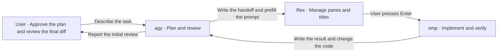

[简体中文](README.md) · [English](README.en.md)

# Rex Handoff


Plan and review with a single model in `agy` on macOS. Delegate implementation to `omp` through `task` or `orchestrate`. Rex carries the handoff prompt between panes in the same tab and displays the project directory and `agy` conversation title.



## Installation

Requirements include macOS, [Rex](https://www.superlogical.com/rex), a plugin-capable [Antigravity CLI (`agy`)](https://antigravity.google/docs/cli), `omp` with the `task` tool, Python 3.9 or later, and Git. The Python scripts use only the standard library with zero external dependencies.

Install directly from GitHub:

```sh
agy plugin install https://github.com/HarryWang29/rex-handoff
```

To install a local checkout, run `agy plugin install ./rex-handoff`. For live development, put the checkout at `tools/rex-handoff` inside the project and merge this `entries` item into the project's `.agents/plugins.json`:

```json
{
  "entries": [
    { "path": "tools/rex-handoff" }
  ]
}
```

To load the checkout in every project, add it to `~/.gemini/config/plugins.json` using the checkout's absolute path. Restart `agy` and use `/plugin`, `/skills`, and `/hooks` to see what loaded. To use the handoff Skill on its own, copy the full `skills/rex-handoff/` directory with its scripts into the project's `.agents/skills/`. The full plugin loads the three lifecycle hooks. [Antigravity customization discovery](https://antigravity.google/docs/customization-discovery?tab=cli)

## Setup

1. Start `agy` in a Rex terminal in the project. Select a single model in `/model` so `omp` handles orchestration.
2. Turn off **Agent Session Naming** in Rex preferences so the built-in feature leaves directory-based session names intact.
3. Ask Rex Handoff in `agy` to run `--doctor` and read `ok`, `checks`, and `warnings` in the JSON report. You can also run it from the plugin root.

```sh
python3 ./skills/rex-handoff/scripts/dispatch_handoff.py --doctor
```

## Workflow

1. **Plan.** Describe your task in `agy` and use `/rex-handoff` to agree on the plan. If `/skills` shows the plugin prefix, select `/rex-handoff:rex-handoff` in autocomplete. `agy` reads the repository constraints, writes a handoff under `/tmp/`, and selects `simple` or `orchestrate`. For example, hand off `feat/user-auth` in `my-app` to `omp`.
2. **Implement.** Rex first looks in the current tab for a running `omp` pane whose working directory matches, contains, or is inside the workspace. It falls back to the first running `omp` pane in that tab, then to an idle interactive shell. By default, a new split goes below for a tall or square terminal or one narrower than 150 columns, and to the right otherwise. The shell's `omp` alias, wrapper, and profile stay available. Check the prefilled prompt and press Enter in the target pane. With `simple`, one `task` subagent implements the change. With `orchestrate`, independent slices run in parallel. The coordinating `omp` model verifies the changes and saves its result under `/tmp/`.
3. **Review.** Ask `agy` to review the Git diff against the handoff and the `omp` result. Review the actual changes in VS Code before accepting them.

## Session and tab titles

- **Session** uses the workspace directory label. A Git repository or worktree uses the name of its own root directory. The first rename requires one tab with a single tiled pane and a two-word, lowercase label like `quiet-meadow`. Rex CLI supplies only the current label, so the first sync can mistake a manual name in the same format for a default. The plugin records the last automatic label in `/tmp/rex-handoff-title-state-<uid>/` and preserves later manual names that differ from that value. [Rex session API](https://www.superlogical.com/rex/docs/reference/api#sessioncreate)
- **Tab** follows the `agy` conversation title through background sync from the SessionStart, PreInvocation, and Stop hooks. Titles come from the local annotations first, with the conversation metadata cache as a fallback. Once `agy` controls the tab title, the shell hook preserves it when `omp` starts in a split in the same tab.
- **Zsh** can also update the initial session and directory tab labels when you open a shell or change directories. Run the command and paste the printed snippet into `~/.zshrc` if you want it. Regenerate the snippet if the script's path changes.

```sh
python3 ./skills/rex-handoff/scripts/rex_auto_title.py print-zsh-hook
```

## CLI and environment

From the plugin root, run `python3 ./skills/rex-handoff/scripts/dispatch_handoff.py`. Set `BypassSandbox: true` when calling it through `agy`'s `run_command`.

| Option | Purpose |
| --- | --- |
| `--handoff PATH` | Handoff file, typically under `/tmp/` |
| `--result PATH` | Where `omp` writes its summary, typically under `/tmp/` |
| `--cwd DIR` | Implementation workspace, defaulting to the current directory |
| `--scale simple\|orchestrate` | One `task` or multiple independent slices, defaulting to `simple` |
| `--lang zh\|en` | Prompt language. Overrides the environment, with Chinese as the default |
| `--model-tag TAG` | Applies to `simple`. The current `omp` profile's `modelRoles.task` is the default. Custom tags get a leading `^`, and `none` or `inline` selects the main `omp` model directly |
| `--direction auto\|below\|right\|above\|left` | Direction for a new split. The default, `auto`, chooses `below` or `right` based on pane size and column count |
| `--dry-run` | Preview the prompt as JSON. Works with prospective file paths and without Rex |
| `--auto-enter` | Submit the prompt after filling it. Omit this option to confirm it with Enter yourself |
| `--doctor` | Print environment checks as JSON. Read `ok` for core readiness. Handoff and result paths are optional |

| Environment variable | Purpose |
| --- | --- |
| `REX_BIN_DIR` | Rex-provided CLI directory, checked before `PATH`. The remaining search order is the user's current Rex Server, app bundles, and Spotlight |
| `REX_SESSION`, `REX_BLOCK` | Current session and pane IDs, provided by Rex |
| `REX_HANDOFF_LANG` | `zh` or `en` when `--lang` is omitted |
| `REX_HANDOFF_AUTO_TITLE` | Enabled by default. Set to `0`, `false`, or `off` to disable renames and keep Rex context injection |
| `SHELL` | Interactive shell queried by `--doctor` if `omp` is missing from `PATH` |
| `PI_CODING_AGENT_DIR` | Directory used when reporting the `omp` `config.yml` path. Defaults to `~/.omp/agent` |

MIT license. [LICENSE](LICENSE)
