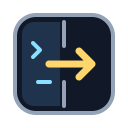
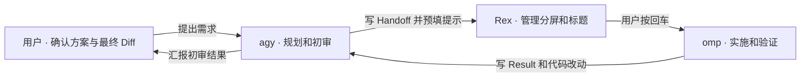

[简体中文](README.md) · [English](README.en.md)

# Rex Handoff



在 macOS 上用 `agy` 的单模型规划和初审，用 `omp` 的 `task` 或 `orchestrate` 实施。Rex 在同一 Tab 的面板之间传递交接提示，并把项目目录与 `agy` 会话标题同步到终端界面。



关于为什么拆成规划/实施两段，以及 `omp` 模型分层、subagent 派发与规则调优的实践经验，见 [工作流与调优指南](docs/workflow-guide.md)。

## 安装

需要 macOS、[Rex](https://www.superlogical.com/rex)、支持插件的 [Antigravity CLI (`agy`)](https://antigravity.google/docs/cli)、提供 `task` 的 `omp`、Python 3.9 及以上，以及 Git。Python 脚本只使用标准库，零外部依赖。

直接从 GitHub 一键安装：

```sh
agy plugin install https://github.com/HarryWang29/rex-handoff
```

若已克隆到本地，也可用 `agy plugin install ./rex-handoff` 安装本地检出。开发调试时如需直接加载源码，可在项目内将仓库检出到 `tools/rex-handoff`，并把下面的 `entries` 项合并到项目的 `.agents/plugins.json`：

```json
{
  "entries": [
    { "path": "tools/rex-handoff" }
  ]
}
```

要在所有项目中使用本地检出，可将该条目加到 `~/.gemini/config/plugins.json`，把 `path` 改成检出的实际绝对路径。重新启动 `agy` 后，用 `/plugin`、`/skills` 和 `/hooks` 查看加载状态。若只需要交接 Skill，可把完整的 `skills/rex-handoff/` 复制到项目的 `.agents/skills/`，保留其中的脚本。三项生命周期钩子随整包插件加载。[Antigravity 自定义内容发现](https://antigravity.google/docs/customization-discovery?tab=cli)

## 设置

1. 在 Rex 的项目终端运行 `agy`。用 `/model` 选择一个单模型，由 `omp` 负责编排。
2. 在 Rex 偏好设置中关闭 **Agent Session Naming**，避免内置功能覆盖目录会话名。
3. 在 `agy` 里让 Rex Handoff 运行 `--doctor`，查看 JSON 的 `ok`、`checks` 和 `warnings`。也可在插件根目录手动执行。

```sh
python3 ./skills/rex-handoff/scripts/dispatch_handoff.py --doctor
```

## 使用流程

1. **规划。** 在 `agy` 说明需求，使用 `/rex-handoff` 讨论方案。若 `/skills` 显示带插件前缀的名称，用自动补全选择 `/rex-handoff:rex-handoff`。`agy` 读取项目约束，在 `/tmp/` 写 Handoff，并选 `simple` 或 `orchestrate`。例如，可把 `my-app` 的 `feat/user-auth` 实施交给 `omp`。
2. **实施。** Rex 在当前 Tab 中优先复用工作目录与实施目录相同或互为父子目录的 `omp` 面板，其次复用该 Tab 中第一个运行中的 `omp` 面板，再尝试复用空闲交互式 Shell。若需新面板，窗口高度不小于宽度或列数不足 150 时默认向下分屏，其余情况向右分屏。插件保留 Shell 中的 `omp` alias、wrapper 和 Profile。请在目标面板检查预填提示后按回车。`simple` 由一位 `task` 子 Agent 实施，`orchestrate` 并行派发独立切片。`omp` 主控统一验证，并把结果写回 `/tmp/`。
3. **初审。** 回到 `agy`，请它按本次 Handoff 和 Result 初审 `git diff`。在 VS Code 中检查实际改动并终审。

## Session 与 Tab 标题

- **Session** 使用工作目录标签。Git 仓库和 Worktree 使用各自根目录名。首次接管限于单 Tab、未分屏且名称符合 `quiet-meadow` 这类小写双词格式的会话。Rex CLI 只提供当前名称，首次同步可能将同格式的手动名称识别为默认值。插件在 `/tmp/rex-handoff-title-state-<uid>/` 记录上次自动值，随后保留与该值不同的手动名称。[Rex Session API](https://www.superlogical.com/rex/docs/reference/api#sessioncreate)
- **Tab** 通过 `agy` 的 SessionStart、PreInvocation 和 Stop 钩子在后台同步会话标题。标题优先取本地 annotations 的 `title`，并可从会话元数据缓存获取。`agy` 接管 Tab 后，即使在同一 Tab 启动 `omp`，Shell 钩子也会保留 `agy` 标题。
- **Zsh** 钩子可选。它在打开终端或切换目录时同步初始 Session 名和未由 Agent 接管的目录 Tab 名。运行下列命令，在确认输出后自行将它粘贴到 `~/.zshrc`。升级或移动插件目录后可重新生成对应路径的片段。

```sh
python3 ./skills/rex-handoff/scripts/rex_auto_title.py print-zsh-hook
```

## 参数与环境变量

从插件根目录运行 `python3 ./skills/rex-handoff/scripts/dispatch_handoff.py`。通过 `agy` 的 `run_command` 运行时设置 `BypassSandbox: true`。

| 参数 | 用途 |
| --- | --- |
| `--handoff PATH` | Handoff 文件，建议位于 `/tmp/` |
| `--result PATH` | 交给 `omp` 写摘要的目标路径，建议位于 `/tmp/` |
| `--cwd DIR` | 实施工作区，默认为当前目录 |
| `--scale simple\|orchestrate` | 单个 `task` 或多个独立切片，默认 `simple` |
| `--lang zh\|en` | 提示语言，优先于环境变量，默认中文 |
| `--model-tag TAG` | 仅用于 `simple`。省略时用当前 `omp` Profile 的 `modelRoles.task`。自定义标签自动补 `^`，传 `none` 或 `inline` 时由 `omp` 主模型直接实施 |
| `--direction auto\|below\|right\|above\|left` | 新建面板的分屏方向。默认 `auto`，按窗口宽高和列数选择 `below` 或 `right` |
| `--dry-run` | 以 JSON 预览提示，可用尚未创建的文件路径且无需 Rex |
| `--auto-enter` | 预填后立即提交提示。省略时由用户按回车 |
| `--doctor` | 输出诊断 JSON，结合 `ok` 判断核心依赖是否齐备，无需 Handoff 或 Result 路径 |

| 环境变量 | 用途 |
| --- | --- |
| `REX_BIN_DIR` | Rex 注入的 CLI 所在目录，优先于 `PATH`。未命中时依次检查当前用户的 Rex Server、App 安装目录和 Spotlight |
| `REX_BLOCK` | Rex 注入的当前面板标识 |
| `REX_SESSION` | 可选的当前 Session 标识。缺失时通过 Rex CLI 自动解析 |
| `REX_HANDOFF_LANG` | 未传 `--lang` 时用 `zh` 或 `en` 指定提示语言 |
| `REX_HANDOFF_AUTO_TITLE` | 默认开启。设为 `0`、`false` 或 `off` 关闭重命名，保留 Rex 上下文注入 |
| `SHELL` | `PATH` 中找不到 `omp` 时，`--doctor` 从此交互式 Shell 查询 |
| `PI_CODING_AGENT_DIR` | `--doctor` 查找 `omp` 的 `config.yml` 时参考的目录，默认 `~/.omp/agent` |

MIT 许可。[LICENSE](LICENSE)
