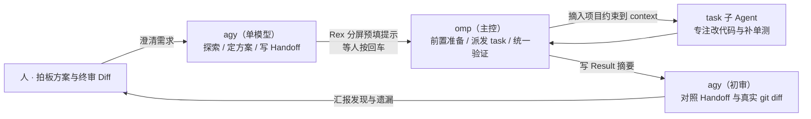

# 用 `agy` + `rex-handoff` + `omp` 跑通高确定性的 AI 编码工作流

> 这份笔记总结了一套已经在实际项目里跑顺的实践：**在 `agy` 里用单模型把方案想透，通过 `rex-handoff` 交给 `omp` 的 subagent 实施和验证，最后再回到 `agy` 做异构初审。**
>
> 核心体感：只要上游方案确认通过，下游产出的代码和单测质量通常能直接满足预期，返工率很低。

---

## 一、核心思路：把“想清楚”和“做出来”拆开

很多人用 AI 写代码容易翻车，不是模型不够强，而是**在同一个上下文里同时做需求澄清、代码探索、方案试错、编码和修 Bug**。几轮下来上下文被大量中间噪音污染，模型很容易忘掉约束、越改越飘。

这套工作流的核心是 **上下文隔离 + 职责边界**：



这样拆开后有两个直接收益：

1. **规划阶段不急着写代码**：单模型把仓库规范、现有实现、边界条件和验收标准摸清楚，方案没对齐前一行代码都不动。
2. **实施阶段上下文极干净**：`omp` 和子 Agent 拿到的是去噪后的明确规格，不背前面的讨论包袱，只按单执行。

---

## 二、怎么把方案写扎实：六段式 Handoff

`rex-handoff` 在交接时会把方案落成一份 `/tmp/handoff-<topic>-<timestamp>.md` 文档。哪怕你不用这个插件，手工维护一份类似结构的交接单，效果也会提升一大截。

交接单固定包含六段，每一段都在防一类常见翻车：

| 段落 | 写什么 | 防什么坑 |
| --- | --- | --- |
| **1. 目标与背景** | 用户意图、可观测的验收行为 | 防模型只按字面改代码，没解决真正问题 |
| **2. 前置动作** | 仓库路径、基准分支（如 `origin/main`）、工作区已有改动、切分支/worktree 顺序 | 防实施方把已有未提交改动当成自己的，或改错分支 |
| **3. 规模与编排** | 选 `simple` 还是 `orchestrate`，明确主控与子 Agent 职责、切片边界与依赖 | 防盲目并行导致合并冲突和接口漂移 |
| **4. 文件与修改规格** | 目标文件/模块、预期行为、边界情况、需要补充的单测 | 防漏掉边界或自己乱造目录结构 |
| **5. 约束与授权** | 适用的仓库 `AGENTS.md`/规则、禁止触碰的文件、是否允许提交 | 防顺手改锁文件、改无关代码或擅自 `git commit` |
| **6. 验证与结果回写** | 主控要跑的精确验证命令、预期结果、Result 摘要的写入路径 | 防模型口头说“已验证”但实际没跑，或漏报限制 |

### `simple` 和 `orchestrate` 怎么选

- **默认选 `simple`**：一个明确范围的修改单元。由 `omp` 主控先完成切分支等前置步骤，再通过 `task` 委派**单个**子 Agent 写代码和单测，完成后由主控统一跑验证。
- **满足条件才选 `orchestrate`**：任务能拆成多个**文件边界不重叠、共享接口已定死**的独立切片时，再让主控并行派发多个 `task` 子 Agent，全部完成后统一验证。
- **一条经验**：不要为了“多 Agent 很酷”强行并行。接口没定死就并行，后期对齐和修冲突的耗时往往大于串行。

---

## 三、`omp` Subagent 的配置与调优

方案写好之后，下游能不能稳稳落地，很大程度取决于 `omp` 侧的两件事：**模型角色分层**和**执行规则约束**。

### 1. 模型角色分层（按职责配模型，不一把梭）

`omp` 支持按 `modelRoles` 和 `task.agentModelOverrides` 为不同角色分配模型。实践下来最顺手的配法是把模型分成四档：

- **主控协调（`default`）**：负责读 Handoff、做前置准备、给子 Agent 摘上下文、跑最终验证和汇总结果。需要强指令遵循和综合编排能力。
- **代码实施（`task`）**：真正动刀写业务代码和单测的子 Agent。直接给手头代码能力最强、推理档位拉满的模型。
- **规划/高难推理（`plan` / `slow` / `advisor`）**：遇到棘手问题或需要复杂权衡时使用。
- **轻量杂活（`smol` / `tiny` / `commit` / `memory`）**：给探路检索类子 Agent（`scout`、`sonic`）、生成 commit 信息、记忆整理等任务用快且便宜的小模型，大幅提速。

脱敏后的 `~/.omp/agent/config.yml` 参考骨架：

```yaml
modelRoles:
  default: <provider>/<strong-orchestrator-model>:high
  task: <provider>/<strongest-coding-model>:max
  plan: <provider>/<strong-reasoning-model>:medium
  slow: <provider>/<strong-reasoning-model>:medium
  advisor: <provider>/<reasoning-model>:medium
  smol: <provider>/<fast-lightweight-model>:low
  commit: "@smol"
  tiny: "@smol"
  memory: "@smol"

# 给关键角色配降级链，避免单通道限流打断整轮执行
retry:
  fallbackChains:
    default:
      - <provider>/<fallback-orchestrator-model>
    task:
      - <provider>/<fallback-coding-model>
    smol:
      - <provider>/<fallback-fast-model>

# 子 Agent 模型映射：探路用快模型，写代码用最强模型
task:
  agentModelOverrides:
    scout: "@smol"
    sonic: "@smol"
    task: "@task"

# 不常自动触发的重型 Skill 改为手动触发，减少每轮上下文噪音
skills:
  manualSkills:
    - <heavy-design-or-domain-skill-1>
    - <heavy-design-or-domain-skill-2>
```

> **多环境小技巧**：如果工作和个人项目走不同的 API 通道或模型组合，可以用 `omp` 的多 Profile（例如默认配置 + `work` Profile）。`rex-handoff` 会保留当前 Shell 里的 `omp` alias、wrapper 和 Profile，不需要额外改插件配置。

### 2. 把规则拆成“主会话偏好”与“主控+子 Agent 共享底线”

在 `~/.omp/agent/` 下，把规则分成两份非常清晰：

- **`AGENTS.md`（作用于主会话）**：管沟通语言、讨论节奏（先给大纲和取舍再写长方案）、任务阶段边界（问原因不等于要立刻改代码）和验证原则（迭代只跑受影响的包，已通过且无新改动不重跑）。
- **`RULES.md`（同时作用于主会话和子 Agent）**：管写代码时的硬底线。真正让子 Agent 少走弯路的是这几条：
  1. **遇阻塞停下汇报**：缺少关键信息、需要重大取舍或将越过授权边界时，停止并在结果中说明，**不要靠猜继续**。
  2. **派发必须摘上下文**：子 Agent 看不到主会话和项目 `AGENTS.md`。主控派发时，必须把本次任务相关的代码规范、目录边界、禁止事项摘进 `context`；同时**过滤掉与子 Agent 职责冲突的条目**（例如“自行跑全量测试”“自行提交”）。
  3. **最小充分实现**：沿用当前项目的分层和同类实现，不另创一套架构；不为假设的未来需求提前加抽象、配置项或兼容分支。
  4. **不顺手乱改**：不碰无关服务、依赖、锁文件、运行时版本和用户已有改动；不为方便 mock 给生产代码硬加接口。
  5. **不静默堆防御复杂度**：不为理论上的竞态或异常偷偷加锁、重试、兜底 `try/catch`；边界输入在入口校验一次，内部直接传递带类型的值。
  6. **未授权不动 Git 历史**：不自动 commit、push、提 PR，也不对外部平台执行写入。

---

## 四、闭环里的几个关键“人工卡点”

这套流程用起来让人放心，恰恰因为它**不是全自动撒手不管**，而是在最划算的地方留了轻量确认点：

1. **派发只预填，默认等回车**
   - `rex-handoff` 会在当前 Rex Tab 里复用已有的 `omp` 面板（或按窗口宽高自动分屏），把派发指令预填好，但默认不自动提交。
   - 花 3 秒扫一眼预填提示和规模（`simple` / `orchestrate`），确认没偏再按回车，比跑完 10 分钟返工划算得多。
2. **主控统一验证 + Result 回写**
   - 代码修改由子 Agent 完成，但**最终验证命令由 `omp` 主控统一执行**，并把变更文件清单、实际跑过的命令及结果、遗留限制写入 `/tmp/handoff-result-*.md`。
3. **回到 `agy` 做异构初审**
   - 切回 `agy`，让它同时读 Handoff、Result 和工作区真实的 `git status` / `git diff`（以及未跟踪文件），逐项核对：
     - Handoff 里的要求有没有漏项？
     - 有没有越界改动或误伤已有改动？
     - 验证结果到底是谁跑的、有没有真正覆盖改动？
   - 相比“自己写完自己说没问题”，换回规划侧做对照审阅，抓漏率高很多。
4. **人在编辑器终审 Diff**
   - 初审过关后，最后在 VS Code 里扫一遍真实 Diff，再决定是否提交。

---

## 五、给刚上手朋友的 3 条避坑建议

1. **先跑通“规划/实施分离 + 交接单”，再折腾插件自动化**
   - 就算先手动开两个终端窗口复制粘贴，只要把“先定清方案 → 写清边界和验证命令 → 交给干净上下文执行 → 对照 Diff 复核”跑顺，体验就已经有质变；之后再上 `rex-handoff` 省掉手工操作。
2. **子 Agent 写歪了，先查 `context` 和规则，别急着换模型**
   - 80% 的子 Agent 翻车不是模型笨，而是主控派发时没把项目的 `AGENTS.md` 规范、同类参考文件和禁止事项传进去，导致子 Agent 按自己的通用习惯发挥。
3. **验证命令一定要写死到具体命令**
   - Handoff 里写“跑一下测试”基本等于没写；写明具体命令（如针对哪个 package 跑哪条 typecheck / unit test），主控执行和后续初审才有明确锚点。
